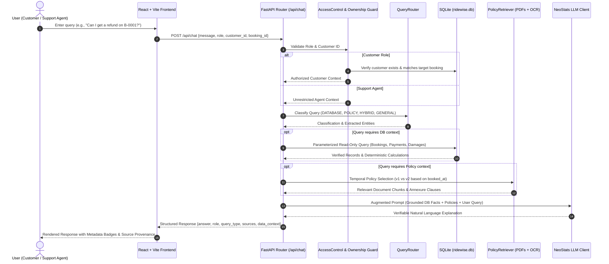

# RideWise Assist Architecture

RideWise Assist is an enterprise AI assistant designed for **RideWise Mobility**. It serves customers and customer support agents by answering operational queries, calculating charges deterministically, interpreting policy rules, and integrating with the NeoStats-hosted LLM.

---

## 1. End-to-End Request Flow

The diagram below illustrates the complete lifecycle of a query from the React UI to the final synthesized response:

---

## 2. Core Architectural Components

### A. Frontend Layer (React + Vite + TypeScript)
- **Role Selector**: Toggles between `Customer` and `Support Agent` modes, enforcing customer ID inputs when required.
- **Chat Interface**: Clean, responsive UI with distinct user and assistant message bubbles, status indicators, and query badges.
- **Centralized API Client (`api.ts`)**: Directs HTTP requests to FastAPI, manages conversation history, and handles network degradation or error states.

### B. Security & Access Control (`auth.py`)
- **Strict Customer Boundary**: Every customer operation is validated against the authenticated `customer_id`.
- **Zero Cross-Tenant Leakage**: If a customer queries a booking belonging to another user (e.g., `CUST0001` querying `B-0002`), the backend rejects the request with HTTP `403 Forbidden` before retrieving records.
- **Support Agent Escalation**: Support agents can inspect any booking, vehicle, customer record, or damage report without restriction.

### C. Database Access & Deterministic Math (`database.py` & `services.py`)
- **Read-Only SQLite Source of Truth**: The original `ridewise.db` is accessed via read-only URIs (`file:...mode=ro`).
- **No Arbitrary SQL Execution**: The LLM is never given direct SQL execution capability. All database interactions use prepared, parameterized queries.
- **Deterministic Calculation Engine**:
  - **Cancellation Refunds**: Computes refund percentages using strict timestamps rather than LLM guesswork.
  - **Policy Version Selector**: Bookings made before 1 July 2026 00:00 IST use **Version 1**; bookings on or after that date use **Version 2**.
  - **Transaction vs Eligibility Distinction**: Differentiates theoretical eligibility from recorded refund transactions in the `payments` table.
  - **Late Return & Tier Benefits**: Applies GOLD tier 30-minute grace period deterministically. If late return exceeds 30 minutes, full penalty (1.5x hourly rate) is calculated from minute 1.
  - **EV Battery Penalty**: Verifies battery level at return against the 10% threshold to compute the ₹150 fee.

### D. Policy Retrieval Engine (`policy_retrieval.py`)
- Ingests all 5 supplied policy PDFs:
  1. `01_Rental_Agreement_and_Terms.pdf`
  2. `02_Cancellation_and_Refund_Policy_v1.pdf`
  3. `03_Cancellation_and_Refund_Policy_v2.pdf`
  4. `04_Late_Return_and_Damage_Penalty_Schedule.pdf`
  5. `05_EV_User_Guide_and_FAQ.pdf`
- **OCR & Scanned Annexure Incorporation**: Contains transcribed tables for Policy v2 signed refund schedule (Annexure 1) and Penalty Schedule tier benefits (Annexure A).
- **Temporal Version Routing**: Automatically filters out conflicting cancellation policy versions based on booking date.

### E. LLM Integration (`llm.py`)
- Uses the official NeoStats-hosted OpenAI API endpoint (`https://neo-hackathon.services.ai.azure.com/openai/v1/`).
- Follows prompt engineering practices: injects verified operational facts, explicit policy clauses, and system boundaries.
- Graceful degradation on rate limits, network timeouts, or missing API keys.
